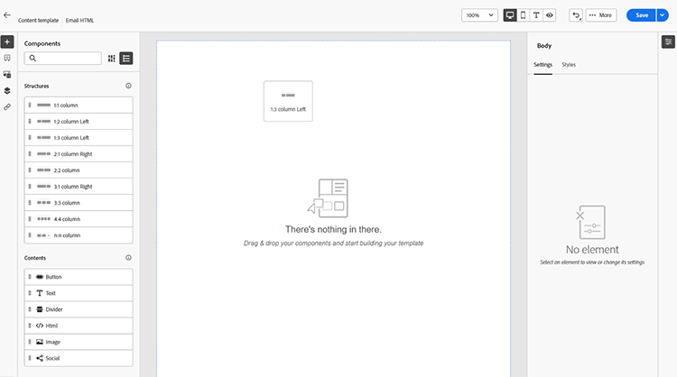
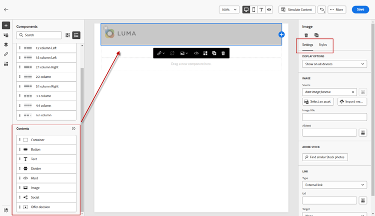

# コンテンツオーサリング – コンポーネント

1. コンテンツの作成または変更を開始するには、構造からアイテムをキャンバスにドラッグ&amp;ドロップします。 右側のペインで設定を編集します。

   >[!TIP]
   >
   >n:n列コンポーネントを選択して、選択した列数（3 ～ 10個）を定義します。 列の下にある矢印を移動して、各列の幅を定義することもできます。

   

   >[!NOTE]
   >
   >各列のサイズは、構造コンポーネントの全幅の10%未満にすることはできません。 削除できるのは空の列のみです。

1. 「コンテンツ」セクションから、目的の項目をドラッグして、1つ以上の構造コンポーネントにドロップします。

   

1. 各コンポーネントは、「設定」タブまたは「スタイル」タブでカスタマイズできます。 フォント、テキストスタイル、余白などを変更します。
