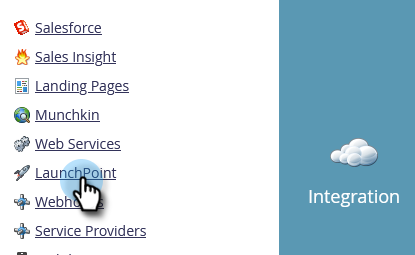
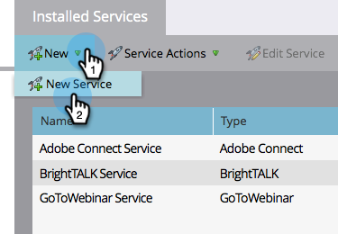
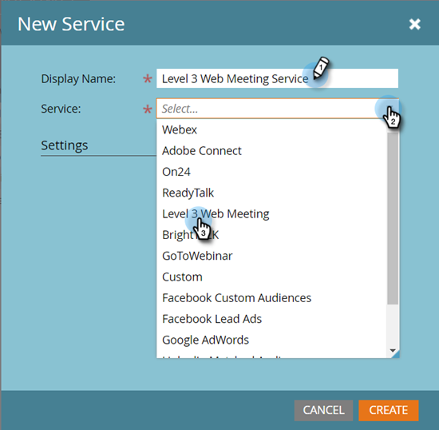
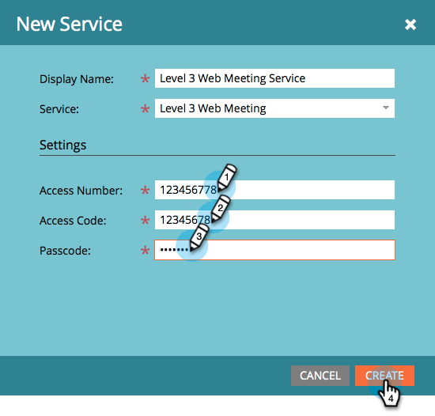
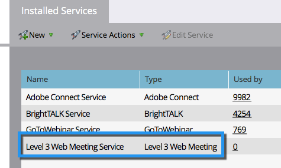

# [!DNL Level 3 Web Meeting] を [!DNL LaunchPoint] サービスとして追加 {#add-level-three-web-meeting-as-a-launchpoint-service}

Marketo は、[!DNL Level 3 Web Meeting] の登録と出席を管理します。

>[!NOTE]
>
>**管理者権限が必要**

>[!NOTE]
>
>この手順を実行するには、[!DNL Level 3 Web Meeting] の既存のサブスクリプションと管理者権限が必要です。 アクセス番号、アクセスコード、パスコードを手元に用意しておきます。

1. マイMarketoで、**[!UICONTROL 管理者]**&#x200B;をクリックします。

   

1. **[!UICONTROL LaunchPoint]**.をクリックします。

   

1. 「**[!UICONTROL 新規]**」を選択し、次に「**[!UICONTROL 新規サービス]**」を選択します。

   

1. **[!UICONTROL 表示名]**&#x200B;を入力します。 「**[!UICONTROL サービス]**」で、「**[!UICONTROL Level 3 Web Meeting]**」を選択します。

   

1. 「**[!UICONTROL アクセス番号]**」、「**[!UICONTROL アクセスコード]**」、「**[!UICONTROL パスコード]**」を入力し、「**[!UICONTROL 作成]**」をクリックします。

   

[!DNL Level 3 Web Meeting] アカウントが Marketo と同期されました。

>[!MORELIKETHIS]
>
>[ [!DNL Level 3 Web Meeting]](/help/marketo/product-docs/demand-generation/events/create-an-event/create-an-event-with-level-3-web-meeting.md){target="_blank"} でイベントを作成する方法を参照してください。
