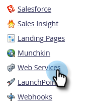
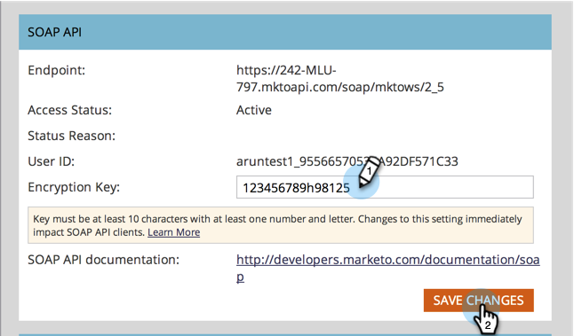

# SOAP API の設定 {#configuring-your-soap-api-settings}

>[!IMPORTANT]
>
>SOAP APIは、2026年7月31日に[非推奨](https://experienceleague.adobe.com/ja/docs/marketo-developer/marketo/soap/soap-api)になります。 代わりに[REST API](https://developer.adobe.com/marketo-apis/)を使用することをお勧めします。

>[!NOTE]
>
>**管理者権限が必要**

1. マイMarketoで、**[!UICONTROL 管理者]**&#x200B;をクリックします。

   

1. 「**[!UICONTROL Web サービス]**」をクリックします。

   

1. 「**[!UICONTROL 暗号化キー]**」に適切な値を設定し、「**[!UICONTROL 変更を保存]**」をクリックしたら、すべての情報を自社の開発者に伝えます。

   

>[!CAUTION]
>
>SOAP エンドポイントと[!UICONTROL  ユーザーID]は一意です。この記事のスクリーンショットを開発者に送信しないでください。
