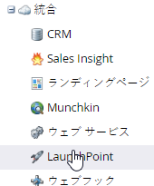
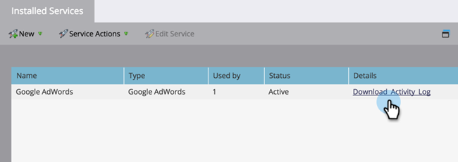

# [!DNL Google Adwords] アクティビティログのダウンロード {#download-googleadwords-activity-log}

アクティビティログをダウンロードして問題をトラブルシューティングする方法を説明します。

1. マイMarketoで、**[!UICONTROL 管理者]**&#x200B;をクリックします。

   

1. **[!UICONTROL LaunchPoint]**.をクリックします。

   

1. [!DNL Google AdWords] サービスを探し、「**[!UICONTROL アクティビティログをダウンロード]**」をクリックします。

   

1. .zip ファイルがコンピューターにダウンロードされます。
