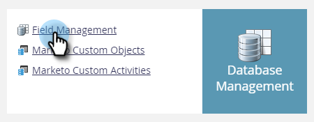
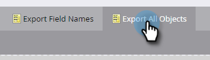
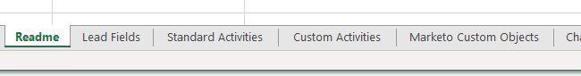

# すべてのオブジェクトメタデータのエクスポート {#export-all-object-metadata}

この機能を使用すると、すべてのオブジェクトとそのメタデータをエクスポートできます。

>[!NOTE]
>
>**管理者権限が必要**

## オブジェクト {#objects}

* リードフィールド（人物／会社）
* Marketo カスタムオブジェクト
* 標準アクティビティ
* カスタムアクティビティ
* チャネル
* タグ

## オブジェクトメタデータのエクスポート {#export-object-metadata}

1. マイMarketoで、**[!UICONTROL 管理者]**&#x200B;をクリックします。

   

1. 「**[!UICONTROL フィールド管理]**」をクリックします。

   

1. 「**[!UICONTROL すべてのオブジェクトをエクスポート]**」をクリックします。

   

>[!NOTE]
>
>お使いのブラウザーがMarketoのポップアップをブロックしていないことを確認します。

データはCSVとして書き出されます。

