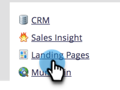
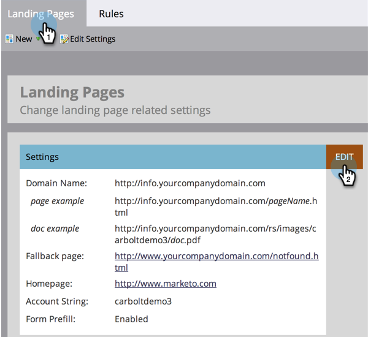
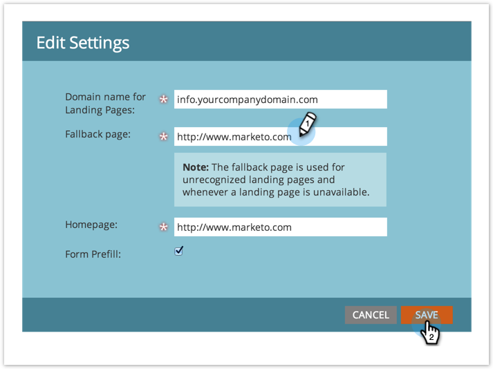

# フォールバックページの設定 {#set-a-fallback-page}

フォールバックページは、ランディングページがオフラインの場合、または見つからない場合の最後の防御線です。 設定していることを確認します。

>[!NOTE]
>
>**管理者権限が必要**

1. マイMarketoで、**[!UICONTROL 管理者]**&#x200B;をクリックします。

   

1. 「**[!UICONTROL ランディングページ]**」をクリックします。

   

1. 「**[!UICONTROL ランディングページ]**」タブで、「**[!UICONTROL 編集]**」ボタンをクリックします。

   

1. ダイアログボックスに、**[!UICONTROL フォールバックページ]**&#x200B;を入力し、「**[!UICONTROL 保存]**」をクリックします。

   
