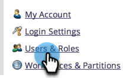
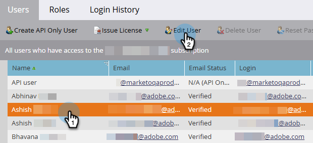
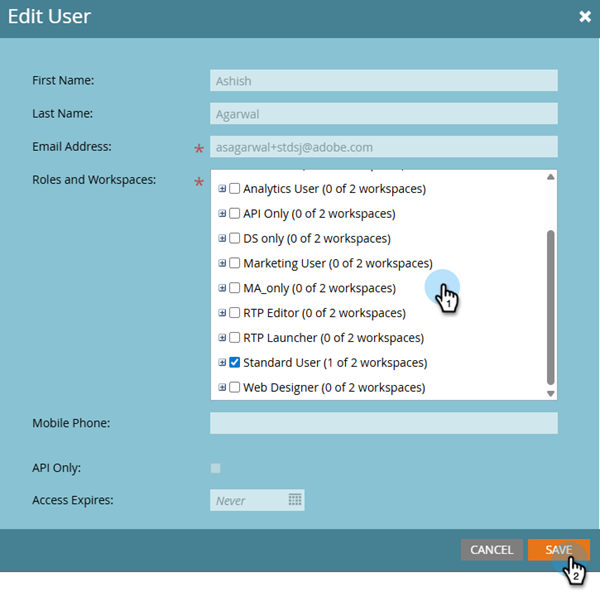

# ユーザーワークスペースの編集 {#edit-user-workspaces}

1. マイMarketoで、**[!UICONTROL 管理者]**&#x200B;をクリックします。

   

1. 「**[!UICONTROL ユーザー＆ロール]**」をクリックします。

   

1. 目的のユーザーを選択し、**[!UICONTROL ユーザーの編集]**&#x200B;をクリックします。

   

1. 必要な変更を行い、**[!UICONTROL 保存]**&#x200B;をクリックします。

   
